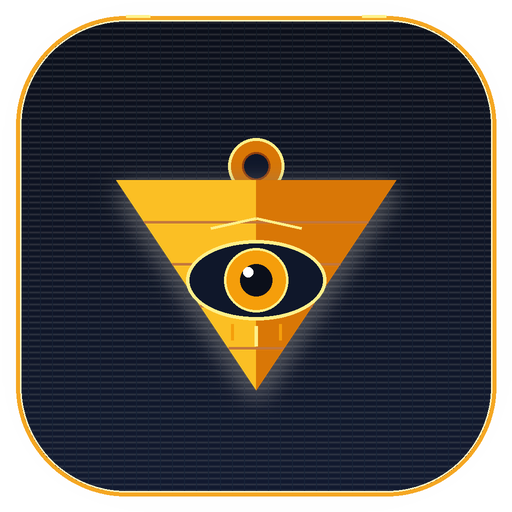

<p align="center">
  
</p>

<h1 align="center">Duel-decomp</h1>

<p align="center">
  <strong>A native Android portrait-mode Yu-Gi-Oh! card game engine & decompilation runner.</strong>
</p>

<p align="center">
  
  
  
  
</p>

---

> **Notice & Disclosure**: This project was conceptualized, architected, and engineered with the assistance of agentic AI via **Arena.ai's Agent Mode**.

---

## Overview

**Duel-decomp** is a clean-room, native Android recompilation runner inspired by [`bryanthaboi/gen1recomp`](https://github.com/bryanthaboi/gen1recomp). It allows fans to play classic portable Yu-Gi-Oh! titles with a modern mobile touch experience, fluid 60 FPS animations, and high-fidelity sound.

### Clean-Room & Legal Architecture
- **Zero Copyrighted Assets Bundled**: The application binary contains no ROM dumps, copyrighted card illustrations, proprietary audio, or game scripts.
- **On-Device Cartridge Extraction**: Users provide their own legally dumped cartridges. Assets, palettes, card statistics, and sound registers are parsed and verified dynamically at runtime.
- **Supported Targets**:
  - **GBA**: *Yu-Gi-Oh! The Eternal Duelist Soul* (USA) — SHA-1: `510fbba212aca9bab95ea12f8fd933e62ee34dea`
  - **GBC**: *Yu-Gi-Oh! Dark Duel Stories* (USA) — SHA-1: `1952d343bdfb5625bd23a8569cde6fd61a911502`

---

## Features

- **Authentic GBA Battle City Campaign**:
  - 5-Tier opponent ladder from *The Eternal Duelist Soul* (Domino High beginners to Battle City finals).
  - Canonical starter deck selection (Black Deck featuring *Armored Lizard*, Red Deck, and Green Deck).
  - Faithfully tuned 40-card opponent deck recipes (e.g. Tristan Taylor's authentic rookie Cookie Deck).
  - Trunk chest inventory management and card rewards.
- **GBC Dark Duel Stories Campaign**:
  - Classic Deck Capacity (DC) and Duelist Level progression.
  - Elemental alignment wheel (*Shadow* $\rightarrow$ *Light* $\rightarrow$ *Fiend* $\rightarrow$ *Dreams* $\rightarrow$ *Pyro* $\rightarrow$ *Forest* $\rightarrow$ *Wind* $\rightarrow$ *Earth* $\rightarrow$ *Thunder* $\rightarrow$ *Aqua*).
- **Official Battle Mechanics**:
  - True-to-TCG Damage Step resolution: attacked face-down monsters flip face-up before damage calculation and remain face-up if defense holds.
  - Interactive Flip Effects (*Man-Eater Bug*, *Needle Worm*, *Morphing Jar*).
  - Intelligent AI evaluating board positions, avoiding suicide wall attacks, and executing multi-monster battle phases.
- **Modern Portrait Mobile UX**:
  - Three-tiered portrait layout: opponent playfield (top), active clash stage (middle), player playfield & hand carousel (bottom).
  - Full-resolution card detail inspection modal with dynamic high-res art streaming.
  - In-game pause menu with duel restart, surrender confirmation, combat log history, 2x AI turbo speed, and retro CRT scanline toggle.
  - Real-time procedural chiptune synthesizer for authentic 8-bit sound effects.

---

## Building from Source

### Prerequisites
- JDK 17 or JDK 21
- Android SDK 34 (Build Tools 34.0.0)

### Run Unit Tests
```bash
./gradlew test
```

### Build Release APK
```bash
./gradlew assembleRelease
```
The compiled APK will be output to `app/build/outputs/apk/release/Duel-decomp-release.apk`.

---

## License & Disclaimer

Yu-Gi-Oh! is a registered trademark of Konami and Kazuki Takahashi. This project is an independent open-source clean-room decompilation runner and is not affiliated with, endorsed by, or associated with Konami Digital Entertainment.
